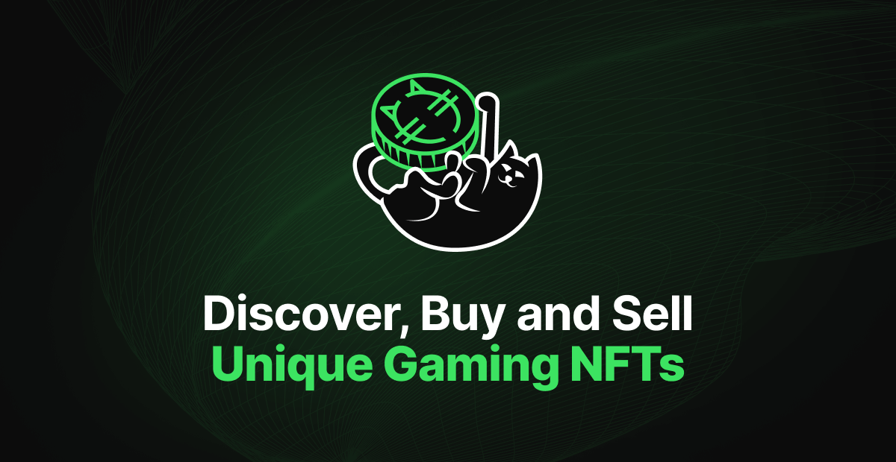

# tanpin-frontend

> Marketplace for gaming NFTs on Polygon: browse collections, buy and sell items, deposit with crypto or card, claim game tokens.



<br>
<h5 align="center">
  <a href="https://tanpin.io">Website</a> ⁃
  <a href="#how-it-works">How it works</a> ⁃
  <a href="#getting-started">Getting started</a> ⁃
  <a href="#deployment">Deployment</a>
</h5>
<br>

Single-page React app for the Tanpin marketplace. The user connects a wallet (MetaMask, WalletConnect, Coinbase or any injected), browses game collections, buys and lists NFTs, tops up the balance through an invoice and claims in-game tokens. Game accounts and Telegram are linked through dedicated auth routes.

## How it works

```
wallet (wagmi / viem) ──▶ React SPA ──▶ REST API + gateway
        │                     │
   Polygon contracts     SWR cache, zustand stores
   (approve, buy, list)
```

Reads and writes to the chain go through wagmi hooks and the contract ABIs in `src/config/ABI`. The active network is a single switch in `src/config/chain.ts` (Polygon mainnet or Amoy testnet). Lists are virtualized, so collections with thousands of items scroll without lag.

| Route | Screen |
|---|---|
| `/`, `/collections`, `/collection/:id` | Home, collections, collection page |
| `/:contractAddress/:tokenID` | NFT page: buy, list, transfer |
| `/assets/owned`, `/assets/sale` | My items and my listings |
| `/activity` | Trades and transfers feed |
| `/deposit`, `/deposit/invoice/:id` | Top up balance, invoice status |
| `/claim`, `/earn/black-russia` | Token claim and game earn page |
| `/:gameID/auth`, `/telegram/auth` | Link a game account or Telegram |

## Tech stack

| | |
|---|---|
| App | React 18, TypeScript, Vite, SCSS |
| Web3 | wagmi 1, viem, WalletConnect |
| Data | SWR, axios, zustand |
| UI | ariakit, framer-motion, embla-carousel, react-virtualized, notistack |
| i18n | i18next |

## Project structure

```
src/
  views/          screens: Home, Collections, Nft, Assets, Deposit, Earn, GameAuth, TelegramAuth
  components/     Nft, Collections, Wallet, Funds, Transaction, Modals, Layout
  config/         chain, wagmi, wallet, contract ABIs
  hooks/          contract, balance, approve, transaction status
  states/         zustand stores
  app/api         axios clients
  app/routing     router, wallet guard
vite.s3.plugin.ts upload of the build to S3 / CDN
```

## Getting started

```bash
pnpm install
pnpm dev
```

## Deployment

Production build is served from a CDN: the Vite plugin uploads assets to S3 and `base` points to the CDN URL.

```bash
pnpm build
```
